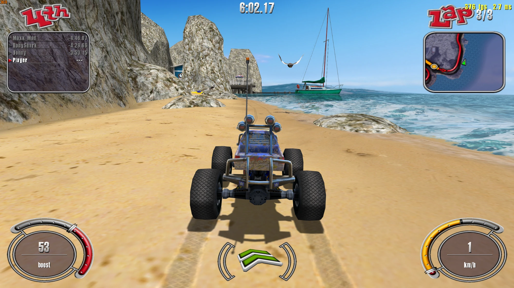

# RcCarsRe

[English](README.md) | **Magyar** | [Русский](README.ru.md) | [Polski](README.pl.md)

Az RcCarsRe egy rajongói projekt, amely a 2003-as **RC Cars** (Creat Studio) PC-s játék futtatható állományát
építi újra visszafejtett C forrásból, hogy a játék a mai rendszereken is fusson és módosítható legyen.

*Gyors verseny az újraépített exében 2560 x 1440-ben, bekapcsolt valós idejű árnyékkal és tükröződéssel.*

> Ez a tároló egyelőre csak ezt a leírást és az előnézeti képet tartalmazza. Forráskód még nincs közzétéve, és
> az eredeti játék semmilyen része nem kerül ide soha.

## Mi ez

- Egy új `RcCarsRe.exe`, amely C nyelven készül az eredeti játék dokumentált viselkedése alapján.
- A játék egy telepített, jogtisztán birtokolt példányának adatfájljait használja (a DVD-s vagy a Steames
  kiadásét). Enélkül nem működik.
- A cél az eredetihez hű viselkedés. Az alapvető rutinokat egy tesztkörnyezet bitre pontosan összeveti az eredeti
  függvényeivel.
- A modern változtatások nem kötelezők, az `RcCarsRe.ini` fájlban kapcsolhatók; a fájl elején minden opció és
  annak lehetséges értékei fel vannak sorolva.

## Modern beállítások

- Direct3D 11 megjelenítő, amely az eredeti Direct3D 8 hívásait emulálja
- Natív felbontás, keret nélküli ablak, szélesvásznú látószög, a kezelőfelület és a HUD méretezése
- Élsimítás (MSAA / FXAA), anizotróp szűrés, legjobb textúraminőség
- Valós idejű árnyék (kaszkádos árnyéktérképek) az eredeti folt-árnyékok helyett
- Valós idejű tükröződés az autókon és szebb tenger (tükörkép, nézőszögtől függő átlátszóság, átlátszó sekély víz)
- Képkockasebesség-korlát és VSync beállítások (nincs 64 fps-es plafon), FPS-számláló
- HD menübetűtípus, HUD-javítások szélesvásznú képernyőre

## Állapot

A munka folyamatban van. Egy gyors verseny elejétől a végéig lejátszható; a többi játékmód még nem kész.

| Terület | Állapot |
|---|---|
| Intró, főmenü, Options, Quick race képernyők | működik |
| Zene, a kezelőfelület és a verseny hangjai | működik |
| Pályabetöltés és -megjelenítés, tenger, parti hab, patakok, vízesések | működik |
| A játékos autójának fizikája: ütközés, felfüggesztés, gumik, motor, kormányzás, antenna | működik |
| Gépi ellenfelek | működik (az eredeti útvonalválasztásuk folyamatban) |
| Verseny: visszaszámlálás, körök, ellenőrzőpontok, helyezések, HUD, térkép, versenyzőlista, eredménytábla | működik |
| Tárgyak fizikával, emberek, sirályok, rákok, kutyák, forgalom, őrök, pókok, keselyűk | működik, finomítás alatt |
| Autóeffektek: keréknyom, por, kipufogófüst, koszolódás, vízfröccsenés | működik |
| Köd, szünetmenü, az őrök és a páncélautó lövése | folyamatban |
| Egyéb játékmódok, garázs, többjátékos mód | nincs elkezdve |
| Modtámogatás (`mods` mappa) | tervezett |

## Amit ez a tároló nem fog tartalmazni

- Az eredeti játék futtatható állományát, könyvtárait, pályáit, modelljeit, textúráit, hangjait vagy bármely más
  tartalmát
- Másolásvédelem megkerülésére szolgáló eszközöket vagy csalásokat

## Jogi tudnivalók

Az RC Cars, valamint a hozzá tartozó nevek és tartalmak a jogtulajdonosaik tulajdonát képezik. Ez egy nem
hivatalos, nem kereskedelmi projekt, amely nem áll kapcsolatban velük, és amelyet nem ők támogatnak. A
használatához saját, jogszerűen megszerzett játékpéldány szükséges. Az előnézeti kép az újraépített exét mutatja
az eredeti játék adataival futás közben.

## Nyelvek

Ez a leírás angolul, magyarul, oroszul és lengyelül érhető el. Az angol változat a mérvadó.
