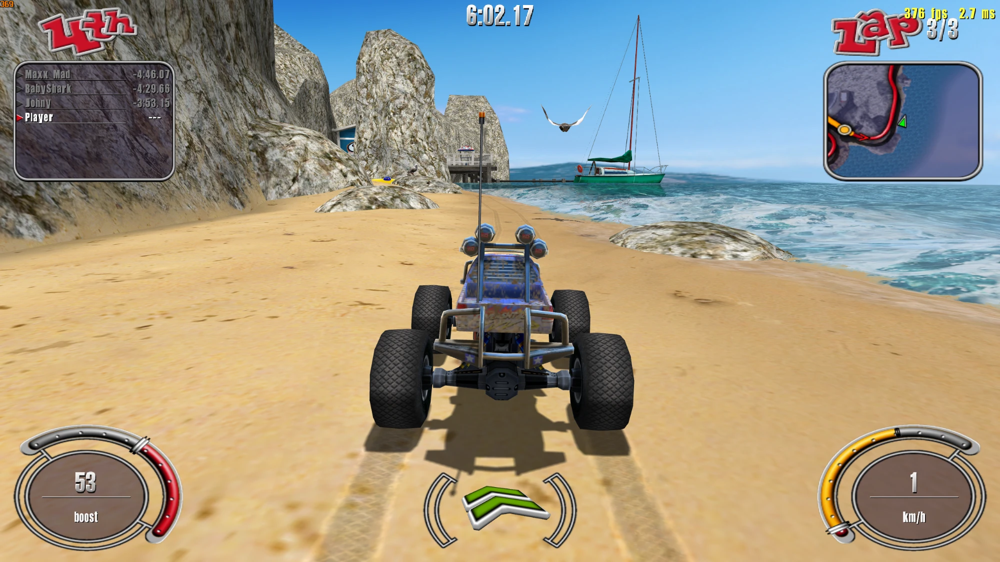

# RcCarsRe

**English** | [Magyar](README.hu.md) | [Русский](README.ru.md) | [Polski](README.pl.md)

RcCarsRe is a fan project that rebuilds the executable of the 2003 PC game **RC Cars** (Creat Studio) from
reconstructed C source, so the game can run on today's systems and be modified.

*A Quick race in the rebuilt exe at 2560 x 1440, with realtime shadows and reflections switched on.*

> This repository currently holds only this description and the preview picture. No source code has been
> published yet, and no part of the original game will ever be published here.

## What it is

- A new `RcCarsRe.exe`, written in C from the documented behaviour of the original game.
- It uses the data files of an installed, legally owned copy of the game (the DVD release or the Steam release).
  It does not work without one.
- The goal is behaviour faithful to the original. Core routines are compared bit for bit against the original's
  functions in a test harness.
- Modern changes are optional and can be switched in `RcCarsRe.ini`, which lists every option and its values.

## Modern options

- Direct3D 11 renderer that emulates the original's Direct3D 8 calls
- Native resolution, borderless window, wide-screen field of view, UI and HUD scaling
- Anti-aliasing (MSAA / FXAA), anisotropic filtering, best texture quality
- Realtime shadows (cascaded shadow maps) in place of the original blob shadows
- Realtime reflections on the cars and an improved sea (mirror image, fresnel, see-through shallows)
- Frame rate limit and VSync settings (no 64 fps cap), FPS counter
- HD menu font, HUD fixes for wide screens
- Screen-space ambient occlusion (SSAO), realtime point lights for lamps and lanterns
- 1280 x 800 (Steam Deck) and any other resolution; menus and HUD scale with the window
- Xbox, PlayStation 4 and DualSense controllers: rumble, DualSense adaptive triggers, a light bar that follows the
  race's GPS arrow (yellow in the menus), shots felt through the DualSense haptics;
  the pad is reset when the game quits
- Split screen for two players (keyboard and mouse or two pads), mouse camera
- VR through OpenXR (SteamVR and others), Discord status in four languages

## Multiplayer

Up to six players over LAN, by direct IP or through a Discord invite, with our own UDP network code (no
DirectPlay, no cross-play with the original exe). The host maps its port with UPnP when the router allows it. In the
lobby and in the race there is a chat, and the host has server commands (kick, ban, say, track and laps) and votes.
Two copies can run on one PC for testing. How it works:
[English](docs/MULTIPLAYER.md) | [Magyar](docs/MULTIPLAYER.hu.md) | [Русский](docs/MULTIPLAYER.ru.md) | [Polski](docs/MULTIPLAYER.pl.md).

## Mods

Game files can be replaced from a `mods` folder next to the exe: folders or zip archives, textures as CSI, PNG or
DDS, sounds and music as AU, WAV, MP3 or OGG, with no size limits. The Mods menu orders and switches them and applies
the changes without a restart. How it works:
[English](docs/MODDING.md) | [Magyar](docs/MODDING.hu.md) | [Русский](docs/MODDING.ru.md) | [Polski](docs/MODDING.pl.md).

## Mod scripting (Lua)

Mods can carry small, sandboxed Lua scripts: HUD texts and pictures, sounds, lap and checkpoint events and a
settings page in the Mods menu. Scripts act only locally (HUD, sound, log); they cannot change the race or the game's
files. Documentation with the full API and example mods (events, camera, fog, sun and water, rumble and light bar, own stats, a photo mode, and
**Zombies**, a whole new game mode built only from the API: new modes appear in the Quick race's Mode row):
[English](docs/modding/LUA_SCRIPTING.en.md) | [Magyar](docs/modding/LUA_SCRIPTING.hu.md) |
[Русский](docs/modding/LUA_SCRIPTING.ru.md) | [Polski](docs/modding/LUA_SCRIPTING.pl.md).
Lua 5.4 is used under the MIT licence ([LUA_LICENSE.txt](docs/modding/LUA_LICENSE.txt)).

**RC Cars and Smash Cars (PS2).** What differs between the PC game and its PlayStation 2 version (cars, physics, jets, air tricks, sounds, levels), found while the PS2 cars and the tutorial level were brought into the rebuilt game as mods:
[English](docs/PS2_DIFFERENCES.md) | [Magyar](docs/PS2_DIFFERENCES.hu.md) | [Русский](docs/PS2_DIFFERENCES.ru.md) | [Polski](docs/PS2_DIFFERENCES.pl.md).

## Status

Work in progress. Quick races and the championship can be played from start to finish, and network races work over
LAN, by direct IP and over the Internet (UPnP or a forwarded port, Discord invites) with the host's world shared;
garage purchases are not ready yet.

| Area | State |
|---|---|
| Intro, main menu, Options, Quick race screens | working |
| Music, interface and race sounds | working |
| Level loading and rendering, sea, coast foam, streams, waterfalls | working |
| Player car physics: collisions, suspension, tyres, engine, steering, antenna | working |
| AI opponents | working (their original path choice is in progress) |
| Race: countdown, laps, checkpoints, placings, HUD, map, racer list, results table | working |
| Props with physics, people, seagulls, crabs, dogs, traffic, guards, spiders, vultures | working, being refined |
| Car effects: tyre tracks, dust, exhaust smoke, dirt, water splashes | working |
| Fog, pause menu | working |
| Guards' and armoured car's shots | in progress |
| Championship with prize money, player profiles, saves in the original format | working |
| Garage | screens working, purchases in progress |
| Split screen for two players; Xbox, PlayStation 4 and DualSense controllers with rumble | working |
| VR (OpenXR), Discord status | working |
| Network multiplayer: LAN, direct IP, Discord invite, UPnP, chat, server commands and votes | working (the host's traffic, people, dogs, guards, crabs, props and shots are synchronised) |
| Mod support (`mods` folder, Mods menu, Lua scripts) | working |

## What this repository will not contain

- The original game's executable, libraries, levels, models, textures, sounds or any other asset
- Tools for bypassing copy protection, or cheats

## Legal

RC Cars and all related names and assets belong to their respective owners. This is an unofficial,
non-commercial project that is not affiliated with or endorsed by them. You need your own legally obtained copy
of the game to use it. The preview picture shows the rebuilt exe running with the original game's data.

## Languages

This description is available in English, Hungarian, Russian and Polish. The English version is the reference.
