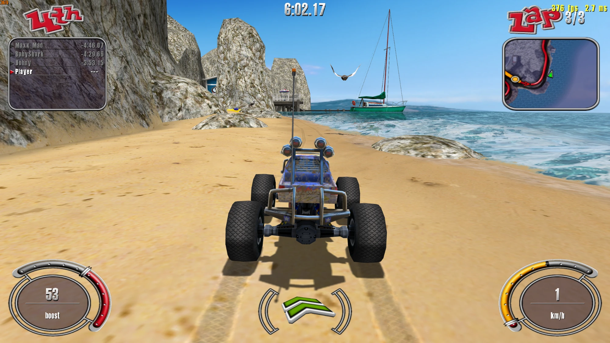

# RcCarsRe

[English](README.md) | [Magyar](README.hu.md) | [Русский](README.ru.md) | **Polski**

RcCarsRe to fanowski projekt, w którym plik wykonywalny gry **RC Cars** (Creat Studio, 2003, PC) jest budowany
od nowa z odtworzonego kodu źródłowego w C, aby gra działała na dzisiejszych systemach i dało się ją modyfikować.

*Szybki wyścig w odbudowanym pliku wykonywalnym w rozdzielczości 2560 x 1440, z włączonymi cieniami i odbiciami
w czasie rzeczywistym.*

> To repozytorium zawiera na razie tylko ten opis i obrazek podglądu. Kod źródłowy nie został jeszcze
> opublikowany, a żadna część oryginalnej gry nigdy nie zostanie tu opublikowana.

## Czym jest ten projekt

- Nowy `RcCarsRe.exe`, napisany w C na podstawie udokumentowanego zachowania oryginalnej gry.
- Korzysta z plików danych zainstalowanej, legalnie posiadanej kopii gry (wydanie DVD lub wydanie Steam).
  Bez niej nie działa.
- Celem jest zachowanie wierne oryginałowi. Podstawowe procedury są porównywane bit po bicie z funkcjami
  oryginału w środowisku testowym.
- Nowoczesne zmiany są opcjonalne i można je przełączać w pliku `RcCarsRe.ini`; na początku pliku wymienione są
  wszystkie opcje i ich możliwe wartości.

## Nowoczesne opcje

- Renderer Direct3D 11 emulujący wywołania Direct3D 8 oryginału
- Natywna rozdzielczość, okno bez ramki, szerokoekranowe pole widzenia, skalowanie interfejsu i HUD
- Wygładzanie krawędzi (MSAA / FXAA), filtrowanie anizotropowe, najlepsza jakość tekstur
- Cienie w czasie rzeczywistym (kaskadowe mapy cieni) zamiast oryginalnych plam cienia
- Odbicia w czasie rzeczywistym na samochodach i ładniejsze morze (odbicie lustrzane, efekt Fresnela,
  przejrzyste płycizny)
- Ustawienia limitu klatek i VSync (bez ograniczenia do 64 kl./s), licznik FPS
- Czcionka menu w jakości HD, poprawki HUD dla szerokich ekranów

## Stan prac

Prace trwają. Szybki wyścig można rozegrać od początku do końca; pozostałe tryby gry nie są jeszcze gotowe.

| Obszar | Stan |
|---|---|
| Intro, menu główne, ekrany Options i Quick race | działa |
| Muzyka, dźwięki interfejsu i wyścigu | działa |
| Wczytywanie i rysowanie poziomów, morze, piana przy brzegu, strumienie, wodospady | działa |
| Fizyka samochodu gracza: kolizje, zawieszenie, opony, silnik, układ kierowniczy, antena | działa |
| Przeciwnicy SI | działa (ich oryginalny wybór trasy w toku) |
| Wyścig: odliczanie, okrążenia, punkty kontrolne, pozycje, HUD, mapa, lista zawodników, tabela wyników | działa |
| Przedmioty z fizyką, ludzie, mewy, kraby, psy, ruch uliczny, strażnicy, pająki, sępy | działa, w trakcie dopracowywania |
| Efekty samochodów: ślady opon, kurz, dym z wydechu, brud, rozbryzgi wody | działa |
| Mgła, menu pauzy, strzały strażników i transportera opancerzonego | w toku |
| Pozostałe tryby gry, garaż, tryb wieloosobowy | nie rozpoczęto |
| Obsługa modów (folder `mods`) | zaplanowane |

## Czego to repozytorium nie będzie zawierać

- Pliku wykonywalnego, bibliotek, poziomów, modeli, tekstur, dźwięków ani żadnych innych zasobów oryginalnej gry
- Narzędzi do obchodzenia zabezpieczeń przed kopiowaniem ani cheatów

## Informacje prawne

RC Cars oraz wszystkie związane z nią nazwy i zasoby należą do ich właścicieli. To nieoficjalny, niekomercyjny
projekt, który nie jest z nimi powiązany ani przez nich wspierany. Do korzystania z niego potrzebna jest własna,
legalnie nabyta kopia gry. Obrazek podglądu pokazuje odbudowany plik wykonywalny działający z danymi oryginalnej
gry.

## Języki

Ten opis jest dostępny po angielsku, węgiersku, rosyjsku i polsku. Wersją odniesienia jest wersja angielska.
