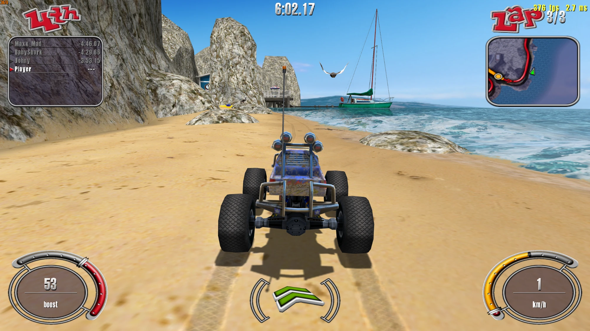

# RcCarsRe

[English](README.md) | [Magyar](README.hu.md) | **Русский** | [Polski](README.pl.md)

RcCarsRe — фанатский проект, в котором исполняемый файл игры **RC Cars** (Creat Studio, 2003, ПК) собирается
заново из восстановленного исходного кода на C, чтобы игра работала на современных системах и её можно было
изменять.

*Быстрая гонка в пересобранном исполняемом файле в разрешении 2560 x 1440 с включёнными тенями и отражениями
в реальном времени.*

> Сейчас в этом репозитории есть только это описание и картинка предпросмотра. Исходный код пока не опубликован,
> а части оригинальной игры не будут опубликованы здесь никогда.

## Что это такое

- Новый `RcCarsRe.exe`, написанный на C по задокументированному поведению оригинальной игры.
- Он использует файлы данных установленной, законно приобретённой копии игры (DVD-издание или издание в Steam).
  Без неё он не работает.
- Цель — поведение, точно соответствующее оригиналу. Основные процедуры побитово сравниваются с функциями
  оригинала в тестовом стенде.
- Современные изменения необязательны и переключаются в файле `RcCarsRe.ini`; в начале файла перечислены все
  параметры и их возможные значения.

## Современные возможности

- Рендерер на Direct3D 11, эмулирующий вызовы Direct3D 8 оригинала
- Родное разрешение экрана, окно без рамки, широкоэкранный угол обзора, масштабирование интерфейса и HUD
- Сглаживание (MSAA / FXAA), анизотропная фильтрация, лучшее качество текстур
- Тени в реальном времени (каскадные карты теней) вместо оригинальных пятен-теней
- Отражения в реальном времени на машинах и улучшенное море (зеркальное отражение, эффект Френеля, прозрачное
  мелководье)
- Настройки ограничения частоты кадров и VSync (без предела в 64 кадра в секунду), счётчик FPS
- HD-шрифт меню, исправления HUD для широких экранов

## Состояние

Работа продолжается. Быструю гонку можно пройти от начала до конца; другие режимы игры пока не готовы.

| Область | Состояние |
|---|---|
| Вступление, главное меню, экраны Options и Quick race | работает |
| Музыка, звуки интерфейса и гонки | работает |
| Загрузка и отрисовка уровней, море, прибой, ручьи, водопады | работает |
| Физика машины игрока: столкновения, подвеска, шины, двигатель, рулевое управление, антенна | работает |
| Соперники под управлением ИИ | работает (оригинальный выбор маршрута в работе) |
| Гонка: обратный отсчёт, круги, контрольные точки, места, HUD, карта, список гонщиков, таблица результатов | работает |
| Предметы с физикой, люди, чайки, крабы, собаки, транспорт, охранники, пауки, грифы | работает, дорабатывается |
| Эффекты машин: следы шин, пыль, выхлоп, грязь, брызги воды | работает |
| Туман, меню паузы, стрельба охранников и бронемашины | в работе |
| Другие режимы игры, гараж, сетевая игра | не начато |
| Поддержка модов (папка `mods`) | запланировано |

## Чего в этом репозитории не будет

- Исполняемого файла, библиотек, уровней, моделей, текстур, звуков и любых других материалов оригинальной игры
- Средств обхода защиты от копирования и читов

## Правовая информация

RC Cars и все связанные с ней названия и материалы принадлежат их правообладателям. Это неофициальный
некоммерческий проект; он не связан с правообладателями и не одобрен ими. Для использования нужна собственная,
законно приобретённая копия игры. На картинке предпросмотра — пересобранный исполняемый файл, работающий с
данными оригинальной игры.

## Языки

Это описание доступно на английском, венгерском, русском и польском языках. Основной считается английская версия.
