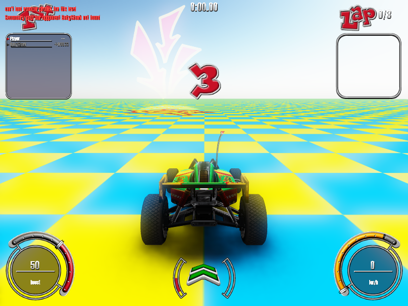

# Saját pálya (minta)

Egy teljes, Blenderben készült saját pálya: egy 200 x 200 m-es sík kockás textúrával, tizenkét ellenőrzőponttal, a
játékos rajtjával, egy gépi ellenféllel és HDRI égbolttal. Ebből látszik, hogyan áll össze egy pálya; utána
elkészítheted a sajátodat.

Ami kell hozzá:

- a játék saját, telepített példánya (DVD vagy Steam) és a **RcCarsRe 0.2.0** vagy újabb (ez olvassa a `.hdr` /
  `.exr` égboltot; [kiadások](https://github.com/FrankHUN88453/RcCarsRe/releases/latest));
- **Blender 4.2** vagy újabb és az **RC Cars Track Editor** addon: `rccars_track_editor-0.1.6.zip` ugyanabból a
  kiadásból (a forrása: [tools/rccars_track_editor](../../../../tools/rccars_track_editor)).

Maga a pályafájl (`RCCarsDB\flat_test.sb`) nincs a repóban: az addon a játék egyik saját pályájának másolatára
építi, a te telepítésedből olvasva, ezért a saját gépeden készül el (4. lépés).

## A minta elkészítése

1. Blender > Edit > Preferences > Get Extensions > jobb fent a menü > *Install from Disk...* > az addon zipje.
2. Az addon beállításaiban (vagy a 3D nézet oldalsávján, N, **RC Cars** fül > *Game*) add meg a **Game folder**-t (a
   mappa, amiben a `RCCARS.exe` van), és nyomd meg a **Scan game folder**-t. Ha a modjaid nem a
   `<játék mappa>\mods`-ban vannak, a **Mods folder**-t is (a `RcCarsRe.exe` melletti `mods` mappa).
3. Nyisd meg ebből a mappából a `flat_test.blend`-et (a `sky.exr` és az `error.png` maradjon mellette). Nyomd meg
   a *Track export* > **Refresh checkpoints**-ot: az ellenőrzőpontok megkapják a jelölőjüket és a hologram nyilukat,
   a játékod textúráiból.
4. Oldalsáv > **RC Cars** > *Track export* > **Export track to mod**. Ez megírja a `mods\flat_test\` modot.
5. Indítsd a `RcCarsRe.exe`-t: *Quick race* > **Flat test** pálya (a játék tíz pályája után).

Ami a jelenetben van:

| Objektum | Mi ez |
|---|---|
| `Ground` | a pálya: 200 m-es rács (50 x 50 négyzet), `error` anyag az `error.png`-vel, az UV 4 méterenként ismétli |
| `RC checkpoint 1` .. `12` | egy 40 m-es körön; az 1-es a rajt-cél vonal (piros nyíl), utána az óramutatóval szemben (zöld nyilak) |
| `RC player start` | a nyíl empty: itt áll a játékos autója, a nyíl irányába nézve |
| `buggy1` | az ellenfél útja: zárt görbe az ellenőrzőpontokon át; az első pontja az autó helye a rajtrácson |
| a jelenet beállításai | Level `flat_test`, Name `Flat test`, az ég `//sky.exr` (500 m sugár), a mod `flat_test` |

## Saját pálya készítése

1. **Modellezd vagy importáld** a pályát. 1 Blender egység = 1 m; egy RC autó kb. 0,4 m hosszú, ezért egy
   valódi méretű autókra készült pályát le kell kicsinyíteni (kb. 1:10). A felfelé irány +Z.
2. **Anyagok**: minden anyag képe (*Image Texture* node a *Base Color*-on) a pálya egy textúrája lesz. Sima szín is
   működik. Az az anyag, amely a kép alfáját használja, átlátszóként rajzolódik (kerítés, levelek). A háló
   vertexszínei (ha vannak) a beégetett fény; nélkülük a pálya teljesen meg van világítva. A játék saját modelljeit
   és textúráit a Blender Asset Browserből is ráhúzhatod (oldalsáv > *Asset browser* > *Build asset library*, majd
   az **RC Cars** könyvtár): a modell az egér alatti felületre kerül, a textúra annak az objektumnak az anyaga lesz,
   amire ráejted.
3. **Ütközés**: minden látható hálón lehet autózni, és neki lehet ütközni. Díszítéshez, amin az autók
   átmennek, jelöld ki az objektumot, és a *Track export* panelen kapcsold ki a *Collision*-t. **Felület**: a
   *Surfaces* panelen (a Track export alatt) anyagonként megadod, min autóznak rajta - aszfalt, homok, nedves homok,
   dűne (kisebb tapadás), kavics, fa, kő, fém; az *Auto* az importált eredeti textúránál a sajátját tartja meg,
   minden másnál aszfalt. Ettől függ az autók gördülési és földet érési hangja; a *Set on N selected object(s)*
   egyszerre több objektumra állítja be.
4. **Ellenőrzőpontok**: tedd a 3D kurzort a helyére, és nyomd meg az *Add checkpoint*-ot; az 1-es a rajt-cél
   vonal, a többi a kör sorrendjében jön. Legalább 2, és annyi, amennyit szeretnél (legfeljebb 256). Mindegyik úgy
   látszik, mint a játékban: a jelölője a talajon és fölötte a hologram nyíl (a rajt-cél vonalnál piros, a többinél
   zöld; a játékban a következő pont fölött áll és villog - lejátszáskor lüktet). Z körül forgatva a jelölője is
   fordul; átszámozás után a *Refresh checkpoints* újra elkészíti őket. A verseny akkor számol kört, ha az autó
   sorrendben áthalad rajtuk, és **az autó csak akkor halad át egy ponton, ha 1,6 m-en belül megy el a közepe
   mellett** (az ellenfél 2,8 m-en belül): tedd őket az út közepére, és az ellenfelek útja menjen át rajtuk - az
   export figyelmeztet, ha egy út elkerül egyet.
5. **Rajt**: a *Player start* (az *NPC paths* vagy a *Track export* panelen) a 3D kurzorhoz teszi a nyilat;
   forgasd Z körül, hogy a nyíl az út irányába mutasson, néhány méterrel az 1-es ellenőrzőpont előtt.
6. **Ellenfelek** (nem kötelező): *NPC paths* > *New opponent path* egy zárt görbét készít; a pontjait vidd végig
   az úton (Edit Mode). Az első pontja az autó helye a rajtrácson. Utanként: az autó, a versenyző, a versenyek,
   amelyekben indul (Easy / Normal / Hard), és a sebessége; egy pont sugara (Alt+S) ott szorozza a sebességet - éles
   kanyar előtt lassíts. Legfeljebb öt ellenfél.
7. **Égbolt** (nem kötelező): egy ekvirektanguláris kép - `.hdr` vagy `.exr` (nagy dinamikatartomány: az
   expozíciót a játék magától állítja be; EXR-ből a ZIP, ZIPS, RLE vagy tömörítetlen), `.png` vagy `.dds`. A szem
   gomb megmutatja a Blenderben is (világként). A pálya köré egy kupolára kerül. A `make_sky.py` ilyen eget készít a
   Blender saját égbolt-textúrájából (`blender -b --factory-startup --python make_sky.py -- <mappa>`).
8. **Level** (a fájl neve és a pálya azonosítója: kisbetű, számjegy és `_`, nem lehet a játék egyik pályája), a
   Quick race oldalon látszó **Name** és **Description** (`\n` sortörés), és a **Mod** mappa.
9. **Export track to mod**. A panel kiírja, mi készült; ha valami hiányzik (nincs rajt, 2-nél kevesebb
   ellenőrzőpont, ...), a Blender info sávja hibát mutat.

## Amit az export ír

A `<mods mappa>\<Mod>\` mappába:

| Fájl | Mi |
|---|---|
| `RCCarsDB\<level>.sb` | a pálya: a hálóid, az ütközési rács, az ellenőrzőpontok a jelölőikkel és a rajt, a játék saját formátumában (a játék `urban_1.sb`-jének másolatára építve; annak emberei, hangjai és tárgyai kimaradnak). Az ütközési rács a játék saját felbontásával készül (0,5 m-es cellák); az ütköző hálók négyzetes csempékre vágódnak (8 m-től), hogy kicsi maradjon |
| `Textures\<level>_<kép>.png` | az anyagok képei (a játék saját textúráját a nevén használja, nem másolja) |
| `Textures\sky_<level>.exr` (vagy `.hdr` / `.png` / `.dds`) | az égbolt |
| `scripts\track_<level>.lua` | `rc.registerTrack{...}`: egy mod `scripts` mappájának minden `.lua` fájlja lefut a játék indulásakor, így a pálya megjelenik a Quick race oldalon |
| `CarProfiles\<level>\*.dat`, `start.dat`, `Scripts\<level>_ai.ini` | az ellenfelek felvett útjai és az AI elrendezés (csak ha a jelenetben vannak ellenfélutak) |

Minden változtatás után exportálj újra; a játékot indítsd újra, hogy lásd.

## Jó tudni

- Az összes mod együtt legfeljebb 24 pályát adhat hozzá.
- A pálya Quick race oldali képét és a verseny közbeni térképét az export nem készíti el (az első pálya képe látszik,
  térkép nincs). Kézzel adhatod hozzá a Lua fájlban: `picture = "<textúra>"`, `loading =`, `shots = {..}`,
  `map = {picture = .., points = {..}}` - lásd az `rc.registerTrack`-et a
  [LUA_SCRIPTING.hu.md](../../LUA_SCRIPTING.hu.md)-ben.
- A jelenetbe tett tárgyak a pálya geometriájának részei lesznek (állnak); vízfelületet az export nem készít.
- Egy másik játék fájljaiból épített pálya attól még annak a játéknak a műve: csak azt oszd meg, amit te készítettél.

## A minta fájljai

| Fájl | |
|---|---|
| `flat_test.blend` | a Blender jelenet (Blender 4.2+, telepített addonnal; az ellenőrzőpontok jelölői és nyilai a játékodból jönnek: *Refresh checkpoints*) |
| `error.png` | a talaj textúrája (a .blend-be is be van csomagolva) |
| `sky.exr` | a HDRI égbolt, a `make_sky.py`-jal készült (a Blender fizikai ege, panorámaként renderelve) |
| `make_sky.py` | HDRI eget készít `.hdr` és `.exr` formában |
| `preview.png` | a pálya a játékban |
