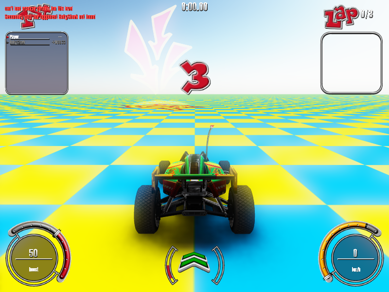

# Custom track (example)

A complete custom track made in Blender: a flat 200 x 200 m field with a checkered texture, twelve checkpoints,
the player's start, one AI opponent and an HDRI sky. Use it to see how a track is put together, then make your own.

You need:

- your own installed copy of RC Cars (DVD or Steam) and **RcCarsRe 0.2.0** or newer (it reads `.hdr` / `.exr`
  skies; [releases](https://github.com/FrankHUN88453/RcCarsRe/releases/latest));
- **Blender 4.2** or newer and the **RC Cars Track Editor** add-on: `rccars_track_editor-0.1.3.zip` from the same
  release (its source is in [tools/rccars_track_editor](../../../../tools/rccars_track_editor)).

The level file itself (`RCCarsDB\flat_test.sb`) is not in this repository: the add-on builds it on a copy of one of
the game's own levels, read from your installation, so you make it on your PC (step 4).

## Build the example

1. Blender > Edit > Preferences > Get Extensions > the menu at the top right > *Install from Disk...* > the add-on's
   zip.
2. In the add-on's preferences (or the 3D View's sidebar, N, tab **RC Cars** > *Game*) set the **Game folder** (the
   folder with `RCCARS.exe`) and press **Scan game folder**. If your mods are not in `<game folder>\mods`, set the
   **Mods folder** too (the `mods` folder next to `RcCarsRe.exe`).
3. Open `flat_test.blend` from this folder (keep `sky.exr` and `error.png` next to it). Press *Track export* >
   **Refresh checkpoints**: the checkpoints get their markers and hologram arrows, made from your game's textures.
4. Sidebar > **RC Cars** > *Track export* > **Export track to mod**. It writes the mod `mods\flat_test\`.
5. Start `RcCarsRe.exe`: *Quick race* > the track **Flat test** (after the game's ten tracks).

What is in the scene:

| Object | What it is |
|---|---|
| `Ground` | the track: a 200 m grid (50 x 50 squares), material `error` with `error.png`, UVs scaled to repeat it every 4 m |
| `RC checkpoint 1` .. `12` | on a 40 m circle; 1 is the start / finish line (red arrow), then anticlockwise (green arrows) |
| `RC player start` | the arrow empty: the player's car starts there, facing along the arrow |
| `buggy1` | the opponent's path: a closed curve over the checkpoints; its first point is the car's place on the starting grid |
| the scene's settings | Level `flat_test`, Name `Flat test`, the sky `//sky.exr` (radius 500 m), the mod `flat_test` |

## Make your own track

1. **Model or import** the track in Blender. 1 Blender unit = 1 m; an RC car is about 0.4 m long, so a track from
   another game made for full-size cars has to be scaled down (about 1:10). Up is +Z.
2. **Materials**: each material's image (an *Image Texture* node on the *Base Color*) becomes a texture of the
   track. Plain colours work too. A material that uses the image's alpha is drawn see-through (fences, leaves).
   Vertex colours, if the mesh has them, are the baked light; without them the track is fully lit. You can also drag
   the game's own models and textures from Blender's Asset Browser (sidebar > *Asset browser* > *Build asset
   library*, then the library **RC Cars**): a model lands on the surface under the mouse, a texture becomes the
   material of the object it is dropped on.
3. **Collision**: every visible mesh is driven on and hit. For decoration the cars should pass through, select the
   object and switch off *Collision* in the *Track export* panel.
4. **Checkpoints**: put the 3D cursor where one should be and press *Add checkpoint*; 1 is the start / finish line,
   the others follow in the order of the lap. At least 2, as many as you like (up to 256). Each one shows what the
   game shows: its marker on the ground and the hologram arrow over it (red at the start / finish line, green at
   the others; in the game it stands over the next checkpoint and blinks - play the animation to see it pulse).
   Rotate a checkpoint about Z to turn its marker; *Refresh checkpoints* makes them again after you renumber them.
   The race counts a lap when the car passes them in order, and **a car passes a checkpoint only within 1.6 m of
   its centre** (an opponent within 2.8 m): put them in the middle of the way, and let the opponents' paths run over
   them - the export warns when a path misses one.
5. **Start**: *Player start* (in the *NPC paths* panel or the *Track export* panel) puts the arrow at the 3D cursor;
   rotate it about Z so the arrow points along the way, a few metres before checkpoint 1.
6. **Opponents** (optional): *NPC paths* > *New opponent path* makes a closed curve; move its points along the way
   (Edit Mode). Its first point is the car's grid place. Per path: the car, the driver, the races it drives in
   (Easy / Normal / Hard) and its speed; a point's radius (Alt+S) scales the speed there - slow down before tight
   turns. Up to five opponents.
7. **Sky** (optional): an equirectangular picture - `.hdr` or `.exr` (high dynamic range: the game sets the exposure
   by itself; EXR with ZIP, ZIPS, RLE or no compression), `.png` or `.dds`. The eye button shows it in Blender as the
   world. It goes on a dome around the track. `make_sky.py` makes such a sky from Blender's own sky texture
   (`blender -b --factory-startup --python make_sky.py -- <folder>`).
8. **Level** (the file name and the track's id: small letters, digits and `_`, not one of the game's levels), the
   **Name** and **Description** (`\n` breaks a line) shown on the Quick race page, and the **Mod** folder.
9. **Export track to mod**. The panel shows what was written; Blender's info bar shows an error if something is
   missing (no start, fewer than 2 checkpoints, ...).

## What the export writes

Into `<mods folder>\<Mod>\`:

| File | What |
|---|---|
| `RCCarsDB\<level>.sb` | the level: your meshes, the collision grid, the checkpoints with their markers and the start, in the game's own format (built on a copy of the game's `urban_1.sb`; its people, sounds and props are left out). The collision grid has the game's own resolution (0.5 m voxels); the collidable meshes are cut into square tiles (8 m and up) to keep it small |
| `Textures\<level>_<image>.png` | the materials' images (a texture of the game itself is used by its name, not copied) |
| `Textures\sky_<level>.exr` (or `.hdr` / `.png` / `.dds`) | the sky |
| `scripts\track_<level>.lua` | `rc.registerTrack{...}`: every `.lua` in a mod's `scripts` folder runs when the game starts, so the track is on the Quick race page |
| `CarProfiles\<level>\*.dat`, `start.dat`, `Scripts\<level>_ai.ini` | the opponents' recorded paths and the AI layout (only when the scene has opponent paths) |

Run the export again after every change; restart the game to see it.

## Good to know

- At most 24 tracks can be added by all mods together.
- The track's picture on the Quick race page and its map on the race screen are not made by the export (the first
  track's picture is shown, and no map). Add them by hand in the Lua file: `picture = "<texture>"`, `loading =`,
  `shots = {..}`, `map = {picture = .., points = {..}}` - see `rc.registerTrack` in
  [LUA_SCRIPTING.en.md](../../LUA_SCRIPTING.en.md).
- Props placed in the scene become part of the track's geometry (they stand still); water surfaces are not made.
- A track built from another game's files is still that game's work: share only what you made yourself.

## Files of this example

| File | |
|---|---|
| `flat_test.blend` | the Blender scene (Blender 4.2+, the add-on installed; the checkpoints' markers and arrows come from your game: *Refresh checkpoints*) |
| `error.png` | the ground's texture (also packed into the .blend) |
| `sky.exr` | the HDRI sky, made with `make_sky.py` (Blender's physical sky, rendered as a panorama) |
| `make_sky.py` | makes an HDRI sky as `.hdr` and `.exr` |
| `preview.png` | the track in the game |
